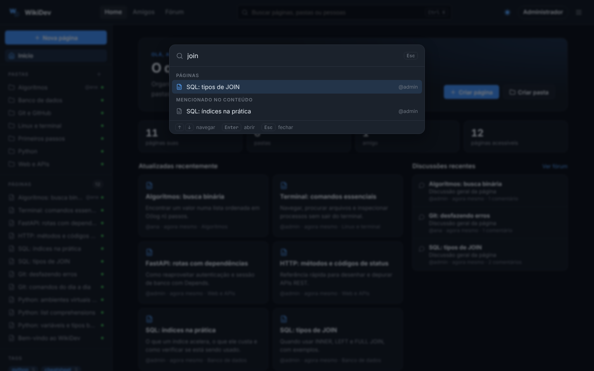
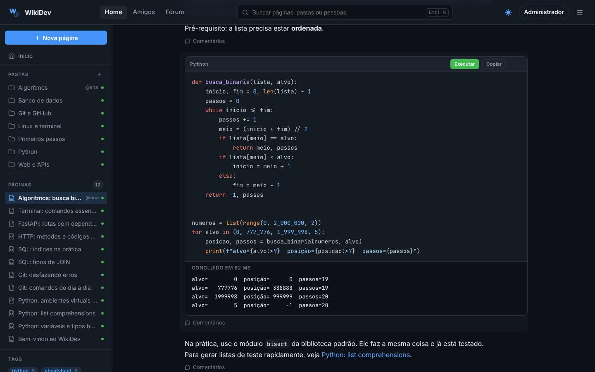
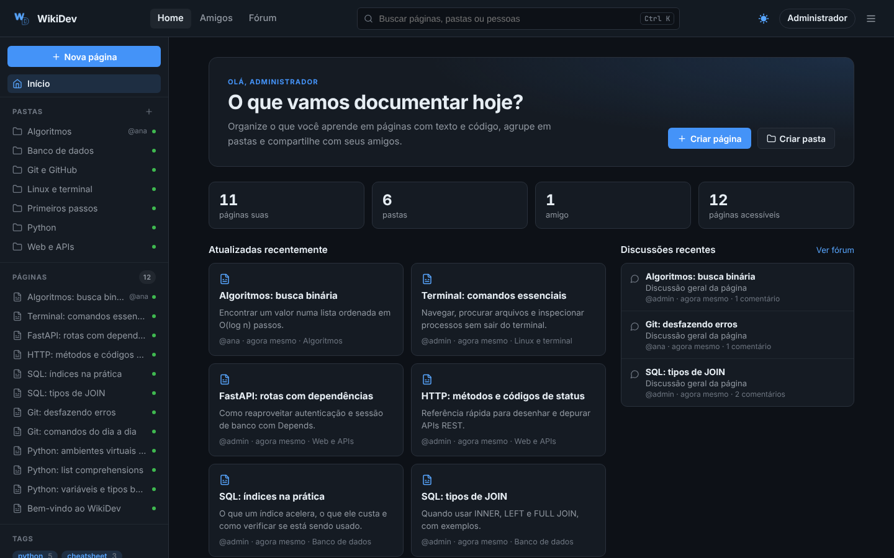
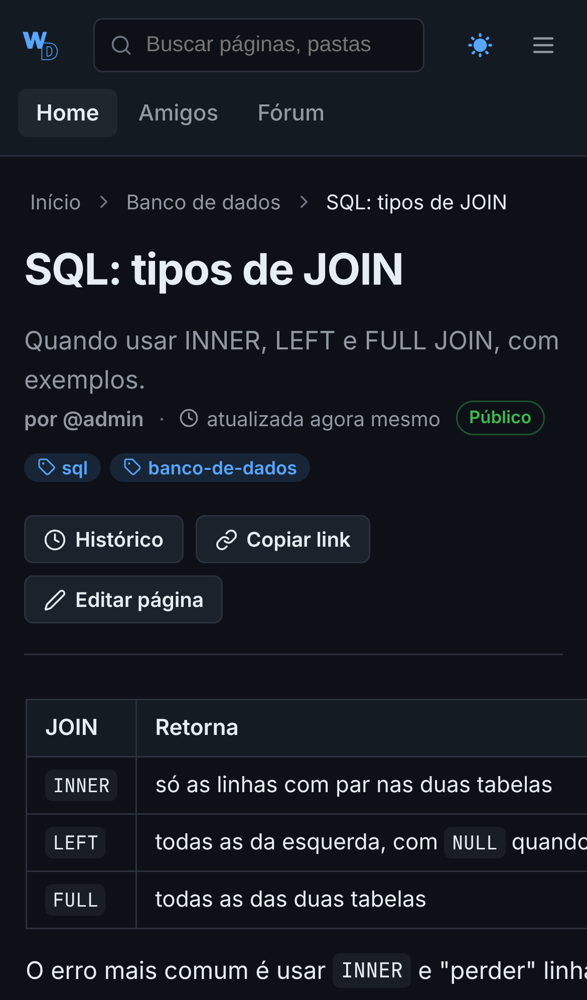

<p align="center"></p>

<h1 align="center">WikiDev</h1>

<p align="center">
  Uma wiki colaborativa para quem programa: páginas com texto em Markdown e código que roda no navegador,<br>
  organizadas em pastas, ligadas entre si e compartilhadas com amigos.
</p>

<p align="center">
  <a href="https://github.com/WikiDev-Team/WikiDev/actions/workflows/tests.yml"></a>
  
  
  
</p>

<p align="center">
  <a href="https://render.com/deploy?repo=https://github.com/WikiDev-Team/WikiDev"></a>
</p>

<p align="center"></p>

## Destaques

- **Código que roda na página.** Blocos de Python ganham um botão "Executar" que usa [Pyodide](https://pyodide.org) dentro de um iframe isolado, sem acesso aos cookies nem à página.
- **Wiki de verdade.** Links com `[[Título]]`, seção "Citada em", páginas por tag e histórico de versões com diff e restauração.
- **Edição simultânea.** Quem está na página aparece no topo, blocos em edição ganham um aviso, mudanças dos outros chegam sozinhas e salvamentos ao mesmo tempo são mesclados linha a linha.
- **Busca instantânea.** Ctrl+K encontra páginas, conteúdo, pastas, tags e pessoas, sempre respeitando as permissões.
- **Social e privado ao mesmo tempo.** Amigos, fórum e comentários por bloco, com páginas privadas, para amigos, públicas ou compartilhadas com pessoas específicas.
- **Pronto para publicar.** Docker, blueprint do Render, testes automatizados e CI.

| Página com Markdown e links | Busca rápida (Ctrl+K) |
|---|---|
|  |  |
| **Python executando no navegador** | **Início** |
|  |  |

<p align="center"></p>

## Experimente

Localmente, em um minuto:

```bash
python -m venv .venv && source .venv/bin/activate
pip install -r requirements.txt
python -m scripts.seed_demo        # 12 páginas de exemplo
uvicorn app.main:app --reload      # http://127.0.0.1:8000, login admin / admin123
```

Ou publique a sua cópia com o botão **Deploy to Render** acima (veja [Publicar online](#publicar-online)).

## Sobre o projeto

WikiDev é uma wiki colaborativa para organizar conhecimento de programação em páginas, blocos e pastas. O backend usa FastAPI e SQLModel; a interface é renderizada com Jinja2 e atualizada com HTMX.

## Funcionalidades

- Cadastro, login, logout e sessões por cookie `HttpOnly`.
- Recuperação de senha por e-mail com token aleatório, armazenado somente como hash, expiração e uso único.
- Páginas compostas por blocos de texto em Markdown (títulos, listas, links, tabelas) e blocos de código com destaque de sintaxe e botão de copiar.
- Link próprio para cada página (`/p/<id>`) e pasta (`/pastas/<id>`), com histórico do navegador, botão "Copiar link" e retorno ao link depois do login.
- Página inicial com favoritas, vistas recentemente e mais vistas, seguida de "Todas as páginas" com filtros (minhas, de amigos, de outras pessoas, por tag ou texto), ordenação (recentes, alfabética, mais editadas, mais vistas) e "Mostrar mais" para listas longas. Os filtros ficam na URL (`/dashboard?owner=friends&tag=python`).
- Barra lateral em árvore: pastas recolhíveis com as páginas dentro, a pasta atual já aberta, páginas carregadas sob demanda ao expandir e estado das pastas lembrado no navegador. Estrela para favoritar páginas.
- Breadcrumbs com o caminho completo de pastas em páginas, pastas e histórico.
- Tags informadas por nome, criadas automaticamente e exibidas na página, com página própria por tag (`/t/<tag>`) e lista de tags na barra lateral.
- Histórico de versões de cada página (`/p/<id>/historico`), com diff por bloco e restauração. Edições seguidas da mesma pessoa em até 5 minutos viram uma só versão.
- Edição simultânea (`app/collab.py`): cada aba manda um sinal a cada 4 s com a versão dos blocos que tem na tela; a resposta mostra quem mais está na página e troca só os blocos que outras pessoas criaram, alteraram ou excluíram. Ao salvar um bloco que mudou desde que foi aberto, as alterações são combinadas por mescla de três vias; se as duas pessoas mexeram nas mesmas linhas, nada é sobrescrito e o formulário volta com marcadores de conflito. A presença fica em memória, então vale para um processo do uvicorn (o padrão do projeto).
- Links entre páginas com `[[Título]]` ou `[[Título|texto]]` e seção "Citada em" com as páginas que apontam para a atual. Só páginas visíveis para o leitor são resolvidas.
- Busca rápida com Ctrl+K (ou Cmd+K) por título, conteúdo dos blocos, pastas, tags e pessoas.
- Botão "Executar" nos blocos de Python, usando Pyodide no navegador. O código roda num Web Worker dentro de um iframe com sandbox (origem opaca, sem acesso a cookies ou ao DOM) e é interrompido após 10 s.
- Pastas hierárquicas sem possibilidade de ciclos.
- Criação de página dentro de pasta e associação ou remoção de páginas existentes.
- Solicitações de amizade, perfis públicos e remoção de amizade.
- Páginas e pastas privadas, públicas, para amigos ou compartilhadas com amigos específicos.
- Permissões separadas de visualização e edição, com revogação dos compartilhamentos diretos ao remover uma amizade.
- Comentários em páginas e blocos são possíveis, possibilitando interação entre os usuários
- Fórum de discussões, apresentando as interações mais recentes visíveis
- Autorização no backend para páginas, pastas, blocos, comentários e exemplos.
- Busca global que respeita as mesmas regras de privacidade.
- Perfis e listagens públicas sem exposição do e-mail.
- Testes automatizados, cobertura e workflow de integração contínua.
- Docker, blueprint do Render, modo de demonstração, seed e smoke test.

## Arquitetura

```text
app/
├── main.py            # aplicação, dashboard e tratamento de erros
├── models.py          # tabelas e schemas SQLModel
├── crud.py            # persistência e geração de slugs
├── permissions.py     # política central de acesso e compartilhamento
├── security.py        # hash de senha e tokens
├── config.py          # configuração por ambiente
├── mailer.py          # envio por console ou SMTP
└── routers/           # auth, páginas, pastas, amizade, busca e APIs

templates/             # páginas e fragmentos HTMX
static/                # CSS (style.css + ui.css), JS, imagens e vendor/ (htmx, highlight.js)
tests/                 # testes funcionais, segurança e CRUD
scripts/               # seed e smoke test
metrics/               # resultados e análise das métricas de qualidade
```

### Visibilidade e estado

O estado da página (`draft`, `published` ou `archived`) é independente da visibilidade (`private`, `friends`, `public` ou `custom`). O autor sempre possui acesso. Páginas em pastas também obedecem à privacidade da pasta e de todos os seus ancestrais: uma pasta filha pública não contorna uma pasta pai privada.

Para visibilidade `custom`, apenas amizades aceitas podem receber acesso direto. Uma pessoa marcada como editora também recebe visualização. Somente o autor pode excluir a página ou alterar seus compartilhamentos.

## Instalação local

Requisitos: Python 3.11 ou 3.12.

```bash
python -m venv .venv
source .venv/bin/activate       # Linux/macOS
# .venv\Scripts\activate      # Windows
python -m pip install --upgrade pip
pip install -r requirements-dev.txt
cp .env.example .env
uvicorn app.main:app --reload
```

A aplicação fica em `http://127.0.0.1:8000`. A documentação OpenAPI fica em `/docs`.

### Dados de demonstração

```bash
python -m scripts.seed_demo
```

O seed cria 12 páginas de referência (Python, Git, SQL, HTTP, FastAPI, terminal e algoritmos) em pastas e tags, com links entre elas, uma amizade e alguns comentários. Pode rodar de novo: as páginas de demonstração são atualizadas para o conteúdo de `scripts/demo_content.py`, e as páginas criadas por pessoas não são alteradas.

Credenciais criadas pelo seed: `admin` / `admin123` e `ana` / `ana12345`. Use apenas em desenvolvimento.

## Recuperação de senha

No desenvolvimento, `MAIL_MODE=console` registra o link de recuperação no terminal. Para envio real:

```env
APP_ENV=production
APP_BASE_URL=https://wiki.exemplo.com
SECURE_COOKIES=true
MAIL_MODE=smtp
MAIL_FROM=WikiDev <no-reply@exemplo.com>
SMTP_HOST=smtp.exemplo.com
SMTP_PORT=587
SMTP_USERNAME=usuario
SMTP_PASSWORD=segredo
SMTP_USE_TLS=true
SMTP_USE_SSL=false
```

O endpoint sempre devolve a mesma mensagem, exista ou não uma conta, evitando enumeração de e-mails. Solicitar novo link invalida os anteriores.

## Testes

```bash
pytest
coverage run -m pytest
coverage report
```

Para testar uma instância em execução:

```bash
python scripts/test_backend.py
```

O GitHub Actions executa a suíte em Python 3.11 e 3.12 em pushes e pull requests para `main` e `develop`.

## Métricas de qualidade

O projeto acompanha SLOC, Índice de Manutenibilidade, Complexidade Ciclomática e métricas de Halstead. Consulte [`metrics/data/METRICS.md`](metrics/data/METRICS.md) para a análise dos resultados.

## Docker

```bash
cp .env.example .env
docker compose up --build
```

O banco SQLite é persistido no volume `wikidev_data`. Com `SEED_DEMO=true`, o container roda o seed de demonstração antes de subir.

## Publicar online

O repositório tem um blueprint do Render ([`render.yaml`](render.yaml)) que sobe o WikiDev no plano gratuito usando o `docker/Dockerfile`:

1. Crie uma conta em [render.com](https://render.com) e conecte o GitHub.
2. Clique em **New > Blueprint**, escolha este repositório e confirme. O botão **Deploy to Render** no topo faz o mesmo.
3. Em alguns minutos o site fica em `https://<nome-do-serviço>.onrender.com`.

O blueprint liga o modo de demonstração:

| Variável | Valor | Efeito |
|---|---|---|
| `APP_ENV` | `production` | Cookies `Secure` e login de desenvolvimento bloqueado. |
| `SEED_DEMO` | `true` | Cria as páginas de demonstração a cada início. |
| `DEMO_MODE` | `true` | Mostra no login um aviso de que é uma demonstração e convida a criar uma conta. |
| `SEED_ADMIN_PASSWORD`, `SEED_ANA_PASSWORD` | gerado pelo Render | Troca as senhas das contas do seed, para que ninguém de fora entre como `admin` ou `ana`. O valor fica em **Environment** no painel do serviço. |

No plano gratuito o disco é temporário e o serviço dorme depois de 15 minutos sem acesso. A cada reinício o banco volta ao conteúdo de demonstração, o que é bom para uma vitrine pública, e a primeira visita depois de dormir demora uns 30 segundos. Para guardar dados de verdade, use um plano com disco persistente montado em `/data`, e desligue `DEMO_MODE`.

## Endpoints principais

| Área | Rotas |
|---|---|
| Autenticação | `POST /register`, `POST /login`, `POST /logout` |
| Recuperação | `GET/POST /forgot-password`, `GET/POST /reset-password` |
| Páginas | `/pages/`, `/pages/{id}`, `/pages/{id}/blocks-editor` |
| Pastas | `/folders/`, `/folders/{id}/pages`, `/folders/{id}/pages/{page_id}` |
| Amizades | `/friends`, `/friendships/request/{user_id}`, `/friendships/{id}/...` |
| Comentários | `/comments/`, `/comments/{id}` |
| Discussões | `/comments/pages/{page_id}/discussion`, `/comments/blocks/{block_id}/discussion` |
| Fórum | `GET /forum` |
| Perfis | `GET /profile/{user_id}` |
| Exemplos | `/examples/`, `/examples/{id}` |
| Busca | `GET /busca?q=...` |
| Saúde | `GET /health` |

## Segurança aplicada

- Senhas com bcrypt e limite de entrada compatível com o algoritmo.
- Cookies `HttpOnly`, `SameSite=Lax` e `Secure` em produção.
- Rotação de sessão no login, armazenamento apenas do hash do token e revogação no logout ou após redefinir a senha.
- Tokens de redefinição não são persistidos em texto puro.
- Autoria definida pelo servidor: `author_id` enviado pelo cliente é ignorado.
- E-mail ausente de schemas públicos.
- Rota de login de desenvolvimento desativada por padrão e proibida em produção.
- Busca e leitura aplicam a mesma política central de permissões.
- Exclusões limpam dependências e compartilhamentos explícitos.

## Migrações

`init_db()` cria as tabelas e contém migrações SQLite idempotentes para bancos anteriores às colunas `page.visibility` e `folder.visibility`. Antes de produção ou de novas alterações de schema, o próximo passo recomendado é adotar Alembic.

## Contribuindo

Leia [`CONTRIBUTING.md`](CONTRIBUTING.md). A descrição técnica desta entrega está em [`docs/contribution-report.md`](docs/contribution-report.md), e o roteiro de apresentação em [`docs/presentation.md`](docs/presentation.md).

## Licença

Distribuído sob a licença MIT. Consulte [`LICENSE`](LICENSE).
